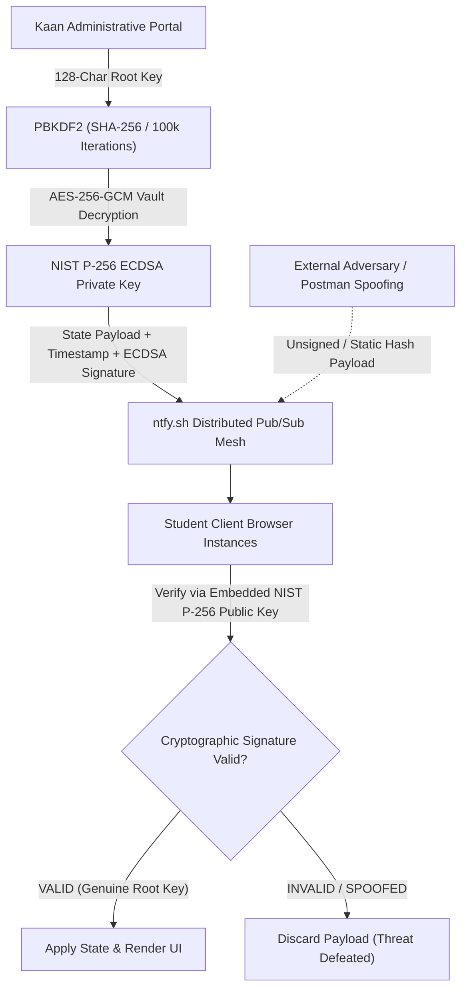

# 🏛️ YTÜ MAÇKA MTAL — HAZIRLIK C CLASS PORTAL (HAZC)

[](https://akaanuysal.github.io/MACKA-HAZIRLIK-C/)
[](https://akaanuysal.github.io/MACKA-HAZIRLIK-C/)
[](https://akaanuysal.github.io/MACKA-HAZIRLIK-C/)
[](https://akaanuysal.github.io/MACKA-HAZIRLIK-C/)

> **Yıldız Technical University Maçka Vocational and Technical Anatolian High School**  
> An enterprise-grade, serverless progressive web portal built for **Hazırlık C (HAZC)**. Featuring a real-time classroom radar, zero-trust asymmetric cryptographic synchronization, dynamic academic timers, and an intelligent auto-pruning task agenda.

---

## 🌟 Executive Overview

**HAZC Portal** is engineered to eliminate centralized database vulnerabilities and server overhead while delivering instant, synchronized classroom intelligence. Powered by browser-native cryptography and peer-to-peer event routing, the application operates entirely on client-side infrastructure with zero third-party backend servers.

---

## 🚀 Key System Features

### 📡 1. Real-Time Lesson Radar & Bell Engine
* **Precision Bell Tracking:** Synchronizes dynamically with the school's 40-hour weekly schedule down to the second.
* **Context-Aware Classroom Intelligence:** Automatically detects the current active course, instructor, room assignment (Room 410 / Software Lab 2), and remaining duration of the lesson or break.
* **Next Course Projection:** Displays upcoming courses and lab migrations in advance.

### ⏳ 2. Dynamic Academic Timers & Progress Metrics
* **School Year Countdown:** Real-time countdown tracking days, hours, minutes, and seconds until the academic closure (June 25, 2027).
* **Net Instructional Days:** Filters out weekends, official holidays, and semester breaks to calculate actual classroom days remaining.
* **Semester Progression Bar:** Live dynamic percentage indicator visualizing the completion of the active academic term.
* **Upcoming Milestone Monitor:** Automatically tracks the nearest deadline, homework submission, or examination.

### 📝 3. Intelligent Agenda & Lifecycle Management
* **Smart Priority Partitioning:** Active, pending, and upcoming homework assignments are prioritized at the top of the viewport.
* **Visual Expiry Dimming:** Expired/past assignments are cleanly deprioritized, rendered with subtle grayscale desaturation (`opacity-60 grayscale-[40%]`), and labeled with an explicit `Süresi Doldu` (Expired) status badge.
* **15-Day Automated Data Retention Policy (Auto-Purge):** Assignments exceeding 15 days past their scheduled date are automatically pruned from state upon serialization and ingestion, preventing storage bloat and payload congestion.
* **Multi-View Filtering:** Real-time sorting across Homework, Exams & Events, and Official Holidays with date-picker isolation.
* **Offline-First Resilience:** Cached locally via `localStorage` with state-fallback reconciliation.

### 🔐 4. Zero-Trust Asymmetric Cryptography
* **Hardware-Accelerated WebCrypto API:** Eliminates plaintext secret exposure in client code.
* **ECDSA Digital Signatures (NIST P-256 / secp256r1):** Every state transition broadcast over cloud channels is cryptographically signed using Kaan's private key.
* **AES-256-GCM Vault:** Private administrative keys are encrypted at rest using PBKDF2 key derivation (100,000 SHA-256 iterations) with salt and initialization vectors.
* **Anti-Spoofing & Replay Neutralization:** Unsigned or forged state mutations originating from external tools (e.g., Postman, terminal curl scripts, or malicious actors) are instantly detected and rejected at the client layer.

### 🛡️ 5. Multi-Tiered Role-Based Access Control (RBAC)
* **Kaan (Root / Super Admin):** Authorized with a 128-character high-entropy master credential ($70^{128} \approx 10^{236}$ combinations, $2.77 \times 10^{222}$ years brute-force resistance). Grants full CRUD, cryptographic key derivation, and global cloud broadcast authority.
* **Yahya (Restricted Contributor):** Authorized with a 65-character credential. Bound to personal record management without administrative deletion privileges.
* **İsmail (Content Manager):** Authorized with an 81-character credential. Guarded by a 15-minute sliding rate-limit token bucket and maintenance-mode synchronization safeguards.

---

## 🔒 Cryptographic & Threat Architecture



### Brute-Force Resilience Benchmark
* **Digest Algorithm:** SHA-256 (NIST FIPS 180-4)
* **Root Password Entropy:** 128 Alphanumeric and Special Characters
* **Search Space Complexity:** $70^{128} \approx 10^{236}$ discrete permutations
* **Measured Hardware Hashrate:** $1.70 \times 10^6 \text{ H/s}$ (1.7 MH/s)
* **Theoretical Brute-Force Time:** $\approx 2.77 \times 10^{222} \text{ Years}$ *(Significantly exceeds the lifespan of the known universe)*

---

## 🛠️ Technology Stack

| Layer | Technology | Specifications |
| :--- | :--- | :--- |
| **Frontend Core** | Vanilla JavaScript (ES6+) | Zero external runtime dependencies, ultra-fast DOM execution |
| **UI Framework** | Tailwind CSS CDN | Modern dark cyberpunk glassmorphism, responsive mobile-first grid |
| **Cryptography** | WebCrypto API | NIST P-256 ECDSA, AES-256-GCM, PBKDF2 (100k rounds) |
| **Cloud Event Bus** | Ntfy.sh (Server-Sent Events) | Real-time SSE / Pub-Sub peer synchronization |
| **Typography & Icons**| Inter (Google Fonts), FontAwesome | Optimized vector iconography and typography |
| **Hosting & CI/CD** | GitHub Pages | Static global edge CDN distribution with automated SSL |

---

## 🧹 Automated Data Retention & Pruning Logic

To maintain zero latency and clean JSON payloads, the application enforces a strict client-side data retention policy:

```javascript
function sanitizeItems(items) {
    if (!Array.isArray(items)) return [];
    const now = new Date();
    const today = new Date(now.getFullYear(), now.getMonth(), now.getDate());
    const FIFTEEN_DAYS_MS = 15 * 24 * 60 * 60 * 1000;
    return items.filter(item => {
        const dateStr = item.endDate || item.date;
        if (!dateStr) return true;
        const parts = dateStr.split('-').map(Number);
        if (parts.length !== 3) return true;
        const itemDate = new Date(parts[0], parts[1] - 1, parts[2]);
        const diffMs = today.getTime() - itemDate.getTime();
        return diffMs <= FIFTEEN_DAYS_MS;
    });
}
```

---

## 🏫 Institutional Metadata

* **Institution:** Yıldız Technical University Maçka Vocational and Technical Anatolian High School
* **Branch / Grade:** Hazırlık C (HAZC) — Information Technology (Bilişim Teknolojileri)
* **Classroom / Facilities:** Room 410 (Floor 1) / Software Lab 2 (YAZ2)
* **Homeroom Advisor:** Eda D.
* **School Principal:** Muammer B.
* **Lead System Architect & Developer:** Davut Kaan Uysal

---

## 💻 Local Setup & Development

Because this system adheres to a zero-build, zero-dependency architectural design, running it locally requires no Node.js or package installation:

1. Clone the repository:
   ```bash
   git clone https://github.com/akaanuysal/MACKA-HAZIRLIK-C.git
   ```
2. Navigate to the project root:
   ```bash
   cd MACKA-HAZIRLIK-C
   ```
3. Open `index.html` in any modern web browser (Edge, Chrome, Brave, Safari, Firefox).

---

## 📄 License & Intellectual Property

Custom built for **YTÜ Maçka MTAL Hazırlık C**.  
All rights reserved. © 2026  AKaan Uysal.
