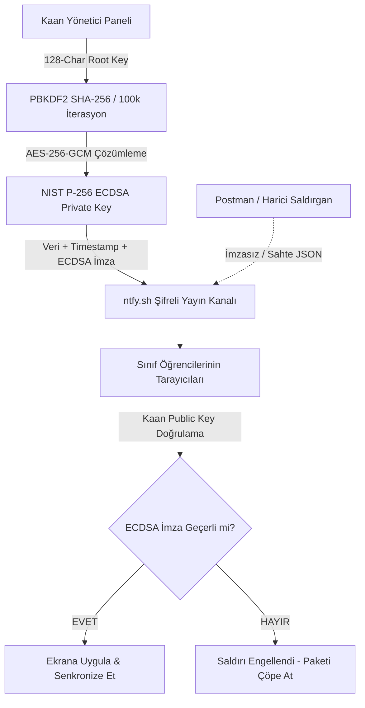

# 🏛️ YTÜ MAÇKA MTAL — HAZIRLIK C PORTALI (HAZC)

[](https://akaanuysal.github.io/MACKA-HAZIRLIK-C/)
[](https://akaanuysal.github.io/MACKA-HAZIRLIK-C/)
[](https://akaanuysal.github.io/MACKA-HAZIRLIK-C/)
[](https://akaanuysal.github.io/MACKA-HAZIRLIK-C/)

> **Yıldız Teknik Üniversitesi Maçka Mesleki ve Teknik Anadolu Lisesi** — Hazırlık C (HAZC) sınıfı için özel olarak geliştirilmiş; gerçek zamanlı ders radarı, sıfır-backend asimetrik şifrelemeli bulut senkronizasyonu ve akıllı ajanda sistemi.

---

## 🌟 Öne Çıkan Özellikler

### 📡 1. Canlı Ders Radarı (Real-Time Lesson Radar)
* Haftalık 40 saatlik resmi ders programını ve okul zil saatlerini milisaniye hassasiyetinde takip eder.
* O an işlenen dersi, ders öğretmenini, dersliği (Kat 1 - 410 / Yazılım 2 Lab) ve teneffüse/derse kalan süreyi dinamik olarak hesaplar.
* Sonraki dersin ne olduğunu otomatik olarak ekrana yansıtır.

### ⏳ 2. Canlı Sayaçlar & Akademik Takvim
* **Okul Kapanış Sayacı:** 25 Haziran kapanış tarihine kalan gün, saat, dakika ve saniyeyi canlı sayar.
* **Net Ders Günü:** Hafta sonları ve resmi tatilleri filtreleyerek fiili olarak okula gidilecek gün sayısını verir.
* **1. Dönem İlerlemesi:** Akademik takvimin tamamlanan yüzdesini canlı ilerleme çubuğuyla görselleştirir.
* **Yaklaşan Görev Sayacı:** En yakın tarihli ödev veya sınav için anlık geri sayım yapar.

### 📝 3. Akıllı Ajanda & Ödev Takip Sistemi
* Sınıfın tüm sınav, quiz, proje ve ödev akışını tek bir ekranda toplar.
* **Filtreleme & Arama:** Tümü, Bekleyenler, Tamamlananlar ve ders bazlı kategorizasyon.
* **Öncelik Etiketleri:** Yüksek (Acil), Orta ve Düşük öncelik rozetleri.
* **Çevrimdışı Desteği:** İnternet kesilse bile yerel hafızadan (LocalStorage) kesintisiz çalışma.

### 🔐 4. Asimetrik Kriptografi & Sıfır Güvenlik Açığı (Zero-Trust)
* Geleneksel merkezi veritabanı açıklarını bertaraf eden **Serverless & Peer-to-Peer** senkronizasyon mimarisi.
* **WebCrypto API (NIST P-256 ECDSA):** Buluta gönderilen her veri paketi Kaan Root gizli anahtarı ile dijital olarak imzalanır.
* **AES-256-GCM Kripto Kasa:** Yönetici anahtarları tarayıcıda PBKDF2 (100.000 iterasyon) ile türetilen AES-GCM 256-bit kasada saklanır. Kod tabanında asla düz metin (plaintext) şifre yer almaz.
* **Anti-Spoofing & Replay Koruması:** Terminalden veya Postman üzerinden Ntfy sunucusuna gönderilmeye çalışılan sahte veya imzasız paketler istemci tarafında anında reddedilir.

### 🛡️ 5. Rol Tabanlı Yetki Sistemi (RBAC)
* **Kaan (Root Admin):** 128 karakterli yüksek entropili anahtar ($70^{128} \approx 10^{236}$ kombinasyon, $2.77 \times 10^{222}$ yıl kaba kuvvet direnci). Tüm ödevleri ekleme, düzenleme, silme ve bulut imzalama yetkisi.
* **Yahya (Kısıtlı Yetkili):** 65 karakterli anahtar. Sadece belirli alanlara müdahale edebilen, ana yönetici verilerini silemeyen korumalı rol.
* **İsmail (İçerik Yöneticisi):** 81 karakterli anahtar. Sistem spam botlarına karşı 15 dakikalık hız sınırı (Rate-Limit token bucket) kalkanı ve bakım modu sayacı.

---

## 🔒 Siber Güvenlik Mimarisi

Sistem, harici bir backend sunucusuna ihtiyaç duymadan istemci tarafında en yüksek askeri sınıf kriptografi standartlarını uygular:



### Kaba Kuvvet (Brute-Force) Dayanıklılık Raporu
* **Hash Algoritması:** SHA-256 (NIST FIPS 180-4)
* **Root Şifre Uzunluğu:** 128 Karakter (Alfanumerik + Özel Karakterler)
* **Arama Uzayı:** $70^{128} \approx 10^{236}$ olası kombinasyon
* **Ortalama Test Hashrate:** $1.70 \times 10^6 \text{ H/s}$
* **Teorik Kırılma Süresi:** $\approx 2.77 \times 10^{222} \text{ Yıl}$ *(Evrenin yaşının trilyonlarca katı)*

---

## 💻 Teknoloji Yığını

| Alan | Kullanılan Teknoloji | Açıklama |
| :--- | :--- | :--- |
| **Ön Yüz (Frontend)** | HTML5, Modern Vanilla JavaScript (ES6+) | Sıfır harici derleme aracı, saf performans |
| **Stil & Tasarım** | Tailwind CSS, Dark Cyberpunk Glassmorphism | Tam duyarlı (Responsive), modern estetik |
| **Kriptografi** | WebCrypto API (ECDSA P-256, AES-GCM, PBKDF2) | Donanım hızlandırmalı tarayıcı içi şifreleme |
| **Bulut Senkronizasyonu** | Ntfy.sh (Pub/Sub Event Bus) | Gerçek zamanlı sunucusuz olay dağıtımı |
| **İkonlar & Tipografi** | Google Fonts (Inter), FontAwesome CDN | Hızlı yüklenen vektörel arayüz elemanları |
| **Dağıtım (Deploy)** | GitHub Pages | Otomatik CDN ve SSL destekli statik barındırma |

---

## 🏫 Okul & Sınıf Bilgileri

* **Kurum:** Yıldız Teknik Üniversitesi Maçka Mesleki ve Teknik Anadolu Lisesi
* **Şube:** Hazırlık C (HAZC) — Bilişim Teknolojileri
* **Derslik:** Kat 1 - 410 / Yazılım 2 Laboratuvarı (YAZ2)
* **Sınıf Öğretmeni:** Eda D.
* **Okul Müdürü:** Muammer B.
* **Proje Sahibi & Sistem Mimarı:** Davut Kaan Uysal

---

## 🚀 Yerel Olarak Çalıştırma

Proje sıfır bağımlılık prensibiyle tasarlandığı için `npm` veya ek paket yükleme gerektirmez:

1. Depoyu klonlayın:
   ```bash
   git clone https://github.com/akaanuysal/MACKA-HAZIRLIK-C.git
   ```
2. Proje dizinine gidin:
   ```bash
   cd MACKA-HAZIRLIK-C
   ```
3. `index.html` dosyasını herhangi bir modern tarayıcıda (Edge, Chrome, Brave, Firefox) çift tıklayarak açın.

---

## 📄 Lisans

Bu proje **YTÜ Maçka MTAL Hazırlık C** sınıfı için özel olarak geliştirilmiştir. Tüm hakları saklıdır. © 2026 Davut Kaan Uysal.
